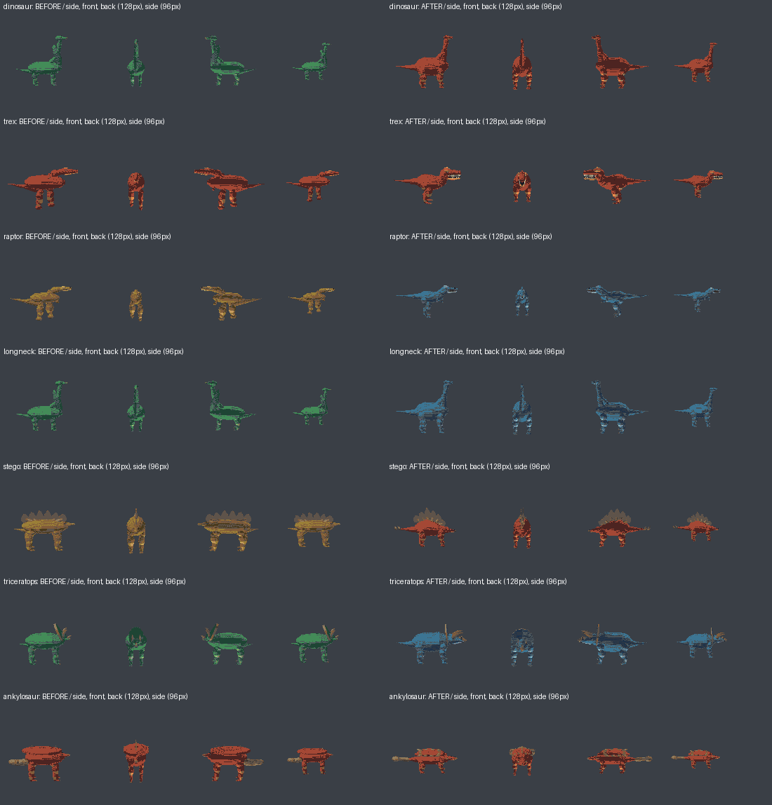
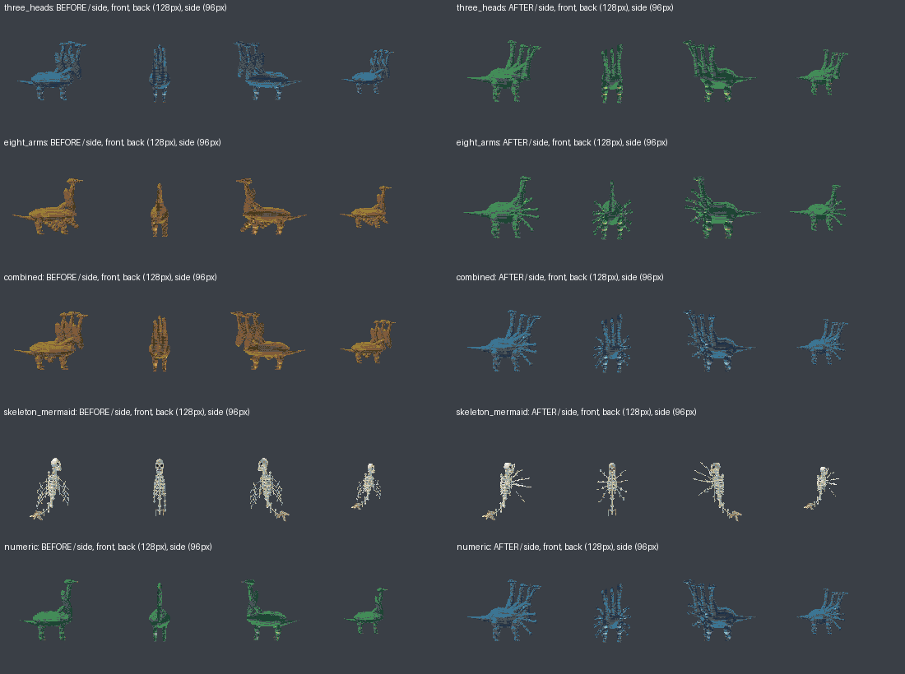

# Dinosaur recipes and explicit-count regression

Actual renderer comparison against main `d64f603`. No AI-generated images or
redrawn silhouettes. V2 remains opt-in; generic `dinosaur` retains its existing
long-necked species default. All requested head/arm counts are represented by
native joints and collision nodes, with attached details moving together.

## Dinosaur shapes

Left: before. Right: after. Each row shows side, front, reverse side on 128px
canvases, then the side on a 96px canvas. Full atlas cells remain dynamically
fitted; these review canvases are nearest-neighbor resizes of those cells.



[Idle, movement and attack animation](evidence/dinosaurs/dinosaurs-motion.gif)
· [Three-seed review](evidence/dinosaurs/dinosaurs-three-seeds.png)

T. rex now has a deep skull, open tooth-bearing jaw and heavy hindquarters;
raptors have a narrower skull and sickle claws. Sauropods have a fuller barrel,
columnar legs and a long neck. Stegosaur plates/spikes, triceratops frills/horns
and ankylosaur armor/clubs are authored on their corresponding articulated nodes.

## Explicit heads and arms

Examples cover spaced, hyphenated and numeric counts, combinations, and skeletal
merfolk. A number binds only to its adjacent body part; species defaults and
seeded limb mutations cannot overwrite it. V2 extra heads have separated neck
branches; extra arms have independent shoulder/elbow chains and motion.



[Modifier animation](evidence/dinosaurs/explicit-modifiers-motion.gif)
· [Three-seed review](evidence/dinosaurs/explicit-modifiers-three-seeds.png)

## Verification

- Exact counts through embedded BERT, optional semantic classifier, vocabulary,
  hybrid recipes and actual threaded WebAssembly generation
- Spelled/numeric/hyphenated forms, mixed head/arm/leg counts, unrelated numbers,
  bounds validation and rider/mount scope
- Counts preserved across 256 seeds and 16 species/modifier combinations
- Exported head, shoulder, arm and hand collider counts, material identity and
  complete nontransparent sprite atlases
- Articulated extra appendages, parent-chain integrity, projected separation,
  fixed bone lengths and attached-detail/material preservation
- 36 rendered specimens: 12 prompts at seeds 0, 7 and 42, with idle/move/attack
  phases reviewed at game scale
- Ordinary V1: 11 specimens compared to clean main on the same host/compiler;
  every PNG/protobuf byte and complete file set identical

The adjacent-count correction also intentionally fixes explicit V1 prompts.
Arbitrary tail cardinality is not implemented; tail numbers are isolated from
head/arm/leg counts and suppress random extra-tail mutation. General prose
outside the documented count and rider/mount grammar is not guaranteed.

## Reproduce

```sh
cargo test --locked --release --no-default-features
cargo test --locked --release
cargo clippy --locked --no-default-features --all-targets -- -D warnings
cargo run --release --example dinosaur_modifiers -- output/dinosaurs
python tools/dinosaur_evidence.py BASELINE_CATALOG output/dinosaurs output/review
# After tools/build_wasm.sh:
node web/wasm/tests/explicit-counts.actual-wasm.node.mjs
```

The Node test loads the real generated WASM binary and starts two Rayon workers.
Only its temporary worker launcher is adapted to Node worker_threads; no parsing,
anatomy, rendering or export behavior is mocked. Browser-worker/isolation coverage
remains in the Playwright suite. Local Chromium could not launch in the restricted
socket sandbox, so browser-specific execution is left to CI.
