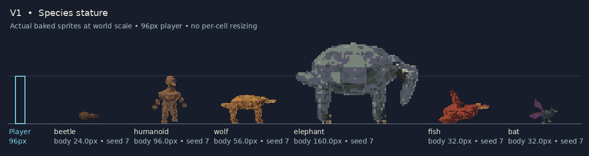
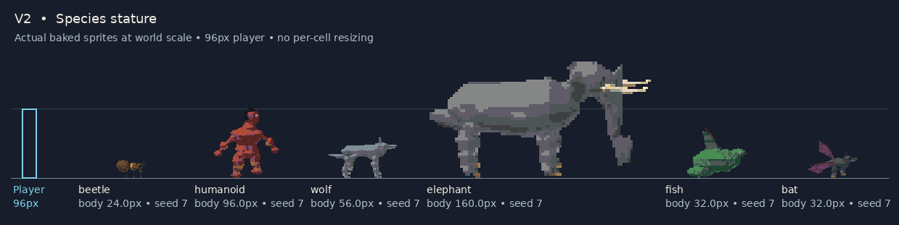
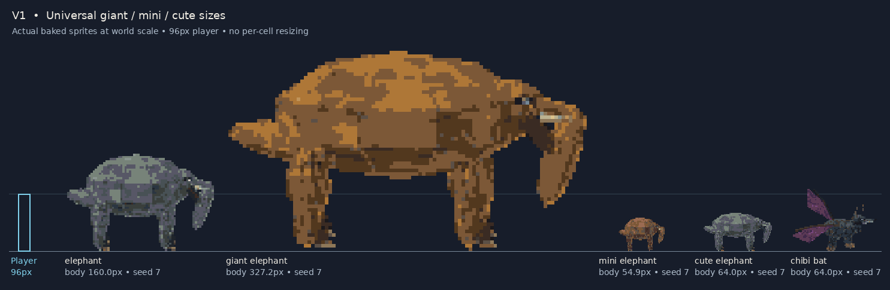
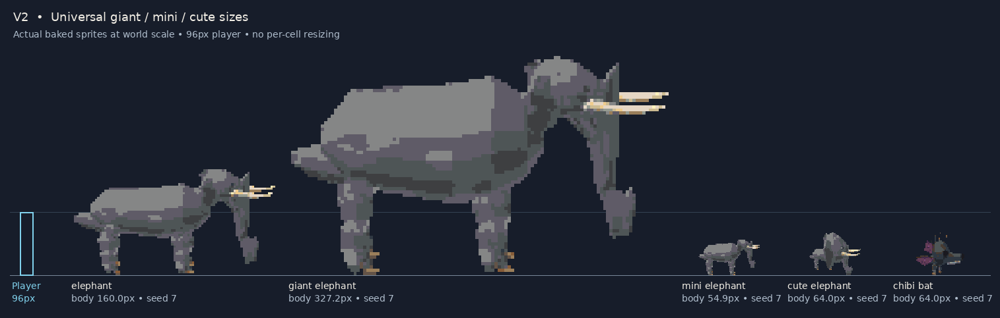
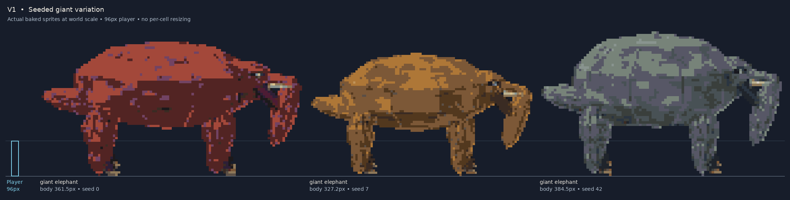
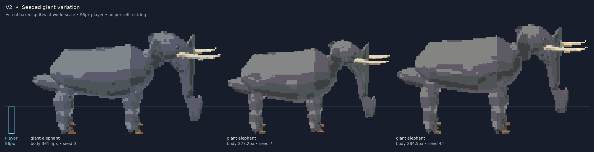

# Actual world-scale renderer evidence

Generated with the vocabulary parser on both V1 and V2, using the exact baked
PNG atlas and exported world scale. The blue reference player is 96px tall.
No specimen is auto-fitted into a common canvas box. Labels give neutral body
height; wing/tail silhouettes and animated poses may extend beyond that body.

- 28 packages
- 17,528 directional animation frames checked
- 0 edge-clipped frames
- Giant elephant seeds 0 / 7 / 42: 361.5 / 327.2 / 384.5px body height
- Mini elephant seed 7: 54.9px; cute elephant and chibi bat: 64px body height

## Species defaults

## Same species, different modifiers

## Deterministic seeded variation

[Exact measurements](measurements.json) · [Same-host V1 compatibility](v1-compatibility.json) · [Policy and integration contract](../../world-scaling.md)

Reproduce with `cargo run --release --no-default-features --example world_scale_catalog`
and `python3 tools/world_scale_evidence.py`. These are procedural renderer outputs,
not AI-generated illustration substitutes.

Validation: 279 native embedded-BERT tests and 274 vocabulary tests passed; strict
no-default-features all-target Clippy and Rust formatting passed. Browser UI
screenshots could not be captured because installed Chromium was blocked by the
cloud sandbox; the images above use actual generated atlas pixels.
